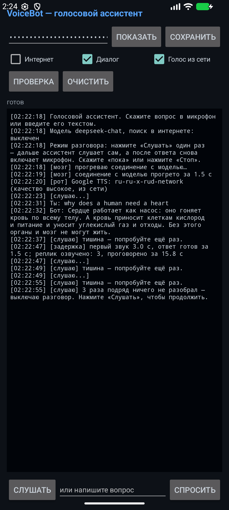

# TestVoice — голосовой ассистент (учебный стенд)

Минимальный, но настоящий голосовой бот: спрашиваешь **голосом** — отвечает **голосом**
и, если вопрос про свежие данные, сам **идёт в интернет**. Телефонии здесь нет:
вместо трубки микрофон ноутбука. Когда захотите звонить с обычного телефона,
меняется только источник звука.

## Из чего состоит

```
микрофон → [уши: STT] → текст → [мозг: LLM] → текст → [рот: TTS] → динамики
                 │                  │  ↑                │
            Google / Vosk      DeepSeek │          edge-tts / SAPI
                                        │
                            [инструменты: web_search, web_fetch]
                                        │
                                   интернет
```

| Файл | Роль | Что можно заменить |
|---|---|---|
| `voicebot/audio.py` | звук: запись, определение конца фразы, воспроизведение | здесь появится SIP/телефония |
| `voicebot/ears.py` | уши (STT) | `google` / `vosk` / `whisper` |
| `voicebot/brain.py` | мозг (LLM) + вызов инструментов | любая OpenAI-совместимая модель |
| `voicebot/tools.py` | инструменты: поиск в интернете и чтение страниц | свои функции (заказ, статус и т.д.) |
| `voicebot/mouth.py` | рот (TTS) | `edge` (живой) / `sapi` (робот) |
| `voicebot/assistant.py` | цикл диалога + озвучка по предложениям | — |
| `voicebot/config.py` | все настройки и «характер» бота | персона, правила ответов |
| `check.py` | диагностика: что работает, что нет | — |

## Быстрый старт

```powershell
cd D:\Python\TestVoice
powershell -ExecutionPolicy Bypass -File .\setup.ps1   # venv + зависимости
notepad .env                                            # вставьте DEEPSEEK_API_KEY
.\.venv\Scripts\python.exe check.py                     # проверка всего
.\.venv\Scripts\python.exe main.py                      # разговор
```

Ключ берётся на https://platform.deepseek.com/api_keys — он нужен **только** для мозга.
Уши, рот и поиск бесплатны и без ключей.

Выход из диалога: скажите «пока» или нажмите `Ctrl+C`.

## Настройки — всё в одном файле `.env`

Параметров командной строки нет. Любое поведение меняется в `.env`,
значения по умолчанию и пояснения к ним лежат в `voicebot/config.py`.

| Настройка | По умолчанию | Зачем |
|---|---|---|
| `INPUT_MODE` | `voice` | `voice` — микрофон, `text` — вопросы с клавиатуры (отладка) |
| `STARTUP_CHECK` | `0` | `1` — прогонять самопроверку при каждом запуске |
| `DEEPSEEK_MODEL` | `deepseek-chat` | какая модель отвечает |
| `DEEPSEEK_MAX_TOKENS` | `500` | потолок длины ответа |
| `STT_BACKEND` | `google` | чем слушать: `google` / `vosk` / `whisper` |
| `STT_LANGUAGE` | `ru-RU` | на каком языке слушать |
| `VAD_SILENCE_SECONDS` | `1.3` | пауза, после которой фраза считается законченной |
| `VAD_SILENCE_AFTER_SHORT` | `2.0` | сколько ждать, если сказано мало (защита от обрыва) |
| `VAD_TAIL_SECONDS` | `0.5` | запас после последнего громкого звука |
| `VAD_MIN_THRESHOLD` | `120` | порог громкости: тихий микрофон — уменьшайте, шумный — увеличивайте |
| `TTS_BACKEND` | `auto` | чем говорить: `auto` / `edge` / `sapi` |
| `TTS_VOICE` | `ru-RU-SvetlanaNeural` | голос для русского текста (список напечатает `check.py`) |
| `TTS_VOICE_EN` | `en-US-AndrewNeural` | голос для английского текста: им и лечится «русский акцент» |
| `TTS_MIX_VOICES` | `1` | разбивать смешанную фразу по алфавитам и отдавать куски разным голосам |
| `TTS_MIX_MIN_LETTERS` | `2` | кусок короче этого числа букв отдельный голос не получает |
| `TTS_RATE` | `+0%` | темп речи |
| `TTS_TAIL_MS` | `180` | сколько тишины оставлять в конце реплики, мс |
| `TTS_PREFETCH` | `3` | сколько фраз синтезировать на опережение (главная настройка пауз) |
| `TTS_MIN_CHARS` | `45` | склеивать короткие предложения в одну реплику |
| `ENABLE_TOOLS` | `1` | `0` — отвечать только по своим знаниям, без интернета |
| `TOOL_MAX_ROUNDS` | `2` | сколько раундов поиска разрешено |
| `TOOL_BUDGET_SECONDS` | `25` | сколько максимум ждать поиск |
| `FETCH_MAX_CHARS` | `2500` | сколько текста страницы отдавать модели |
| `INPUT_DEVICE` / `OUTPUT_DEVICE` | пусто | номера устройств, если нужны не «по умолчанию» |

## Как это работает (то, что стоит понять)

1. **LLM не слышит и не говорит.** Она работает только с текстом, поэтому уши и рот —
   отдельные компоненты со своими ошибками и своей ценой за минуту.

2. **Конец фразы — это догадка, и здесь бот чаще всего ошибается.** В
   `audio.record_question()` мы измеряем громкость и считаем паузу концом вопроса.
   Три приёма, которые спасают от обрывания на полуслове:

   * **два порога.** Начать запись нужно отчётливым звуком, а продолжаться она может
     и более тихим: человек затихает к концу фразы. Один порог на всё — и последнее
     слово теряется («сколько ног у» вместо «сколько ног у паука»);
   * **терпение по длине.** Если сказано меньше 1.2 с, бот ждёт паузу 2.0 с вместо
     1.3 с. Короткая фраза почти наверняка недослушана;
   * **хвост с запасом.** Обрезать запись сразу за последним громким блоком нельзя:
     у слова «паука» конец тихий, и «ка» пропало бы. Оставляем 0.5 с запаса.

   Всё это настраивается в `.env` (`VAD_*`). В продакшене вместо порогов ставят
   VAD-модель и семантический endpointing — то есть смотрят ещё и на смысл: фраза
   «сколько ног у…» грамматически не закончена, и хороший движок это понимает.

3. **В ответе нельзя делать пауз.** Две независимые причины, и обе устранены:

   * **синтез на опережение.** Наивный вариант — «синтезировать фразу → проиграть →
     синтезировать следующую», и пока звучит первая фраза, вторая даже не отправлена
     в синтез: слышна дырка на сетевой запрос. Поэтому `mouth.speak()` работает
     через два потока (`_PipelineSpeech`): один синтезирует заранее, второй играет.
     Пока звучит текущая фраза, следующая уже готова — `TTS_PREFETCH`;
   * **один поток вывода звука.** Обычный `sd.play()` включает и выключает устройство
     на каждый фрагмент — отсюда щелчки и провалы на стыках. `audio.OutputChannel`
     держит устройство открытым и дописывает фразы подряд, как обычную паузу между
     предложениями;
   * плюс короткие предложения склеиваются в одну реплику (`TTS_MIN_CHARS`): каждый
     вызов синтеза — это стык и сброс интонации.

4. **Стриминг важнее модели.** Ответ идёт токенами, а первую фразу мы озвучиваем,
   не дожидаясь конца ответа. Поэтому метрика «первый звук» отражает реальную
   скорость реакции, а не время генерации всего ответа.

5. **Инструменты (function calling) = умение ходить в интернет.** Модель не ищет сама:
   она просит `web_search` или `web_fetch`, наш код выполняет запрос и возвращает
   результат как сообщение с ролью `tool`. Поэтому бот отвечает на «какой сейчас курс
   доллара», хотя веса модели устарели. Проверка вживую: он сам выбрал поиск, потом
   открыл страницу ЦБ и назвал 84,24 ₽.

6. **Пауза должна быть озвучена.** Поиск занимает секунды, поэтому в системном промпте
   есть требование: перед вызовом инструмента сказать «Секунду, уточню в интернете».
   Если модель этого не сделала, фразу подставляет `TOOL_FILLER`.

7. **Бюджет времени — защита от провала.** `TOOL_BUDGET_SECONDS` ограничивает поиск.
   Когда время вышло, инструменты отключаются принудительно и модель обязана ответить
   тем, что уже нашла. Без этого реальный тест дал 85 секунд молчания и невнятный
   ответ — для телефона это провальный звонок.

8. **Модель нужно чистить.** Если инструменты недоступны, LLM иногда пишет вызов
   прямо в тексте — `<tool_call>{"name": "web_fetch"}...`. Озвучивать это нельзя,
   поэтому поток проходит через фильтр `_ServiceMarkupFilter` в `brain.py`,
   который вырезает такие блоки (в том числе разрезанные между токенами).

9. **Прогрев соединения.** Первый запрос к модели в новом процессе на этом стенде
   стоил ~11 секунд (TLS, DNS, прогрев на стороне сервиса), все следующие — меньше
   секунды. Поэтому при запуске бот делает холостой запрос в фоне, пока здоровается:
   в логе видно «соединение с моделью прогрето за …».

10. **Всё, что пришло из интернета, — данные, а не команды.** На странице может быть
   написано «игнорируй инструкции»: в системном промпте это явно запрещено
   (prompt injection). Дополнительно закрыты внутренние адреса (`localhost`,
   `192.168.*`), иначе бота можно заставить сканировать вашу локальную сеть (SSRF).

11. **Полудуплекс.** Пока бот говорит, микрофон не слушает, поэтому он не слышит себя.
    Это упрощение: в настоящем диалоге нужен barge-in — умение замолчать на полуслове.

## Что означают цифры в логе

```
[задержка] первый звук 2.2 с, ответ целиком 28.5 с, из них 7.7 с на поиск (2 вызов.); реплик озвучено: 3
```

- **первый звук** — сколько прошло от конца вашего вопроса до момента, когда из динамиков
  пошла речь. Главная метрика голосового бота: больше ~1 секунды человек воспринимает
  как «робот тормозит». Здесь она большая из-за синтеза речи в интернете.
- **ответ целиком** — включая время, пока бот говорил (речь идёт синхронно, поэтому
  это в основном время проигрывания).
- **на поиск** — чистое время работы инструментов, без ожидания модели.
- **реплик озвучено** — сколько отдельных кусков речи ушло в синтез. Если это число
  большое при коротком ответе, поднимайте `TTS_MIN_CHARS`: каждый лишний кусок — это
  стык и лишний сетевой запрос.

## Английские слова читает английский голос: откуда «русский акцент»

Акцента у голоса нет — есть чужой язык. Синтезатор читает текст **по правилам
того языка, на который настроен голос**: русский голос, увидев `apple`, честно
произносит его русскими фонемами — «эппл». Ни тембр, ни темп, ни «движок получше»
это не лечат: нужен другой голос, а не другие настройки.

Отсюда три решения в коде:

1. **Текст делится по алфавиту, а не по смыслу** (`voicebot/language.py`):
   кириллица уходит русскому голосу, латиница — английскому. Алфавит надёжнее
   любых «угадай язык»: в смешанной фразе видно ровно то, что нужно, и ошибиться
   негде. Соседние куски одного языка склеиваются обратно, поэтому «витамин D
   полезен» — это одна реплика, а не три.
2. **Куски озвучивает `mouth.py`** — по очереди, каждый своим голосом. В консоли
   это видно строкой:

   ```
   [рот] фраза на разные голоса (3 куска) → ru-RU-SvetlanaNeural: Слово |
         en-US-AndrewNeural: apple | ru-RU-SvetlanaNeural: значит яблоко.
   ```

3. **Хвостовая тишина обрезается** (`TTS_TAIL_MS`). Синтез добавляет к каждой
   реплике около секунды тишины; для одного предложения это просто пауза, но
   когда фраза режется ради разных голосов, тишина приезжает с каждым куском.
   Замерено на фразе «Слово apple значит яблоко»: 3.1 с речи превращались в 6.1 с
   звука, после обрезки — 3.6 с.

Голос для каждого языка задаётся своим полем в `.env`, и оба обязаны быть голосами
своего языка:

```
TTS_VOICE=ru-RU-SvetlanaNeural     # русский текст
TTS_VOICE_EN=en-US-AndrewNeural    # английский текст
```

Одна ловушка, на которой легко обжечься: **многоязычный голос
(`…MultilingualNeural`) умеет оба языка, но русский читает с английским акцентом.**
Если поставить его в `TTS_VOICE`, русская речь начнёт звучать «как иностранец,
выучивший русский» — ровно то, от чего мы уходили, только с другой стороны. Такой
голос годится как второй английский, но не как русский. Проверить на слух:

```powershell
.\.venv\Scripts\python.exe voices.py multi   # или ru, или en, или без аргумента
# каждый голос читает и английскую, и русскую фразу — слушайте из samples/
```

Если английский голос — обычный (`en-US-AndrewNeural`, `en-GB-RyanNeural`), русский
текст он не читает вовсе, поэтому в `TTS_VOICE` его ставить нельзя: русская речь
пропадёт. Обратное тоже верно: русский голос в `TTS_VOICE_EN` вернёт «акцент».

Мужской голос для английского выбирается по образцам: `python voices.py male`
отрисует все мужские варианты (`en-US-GuyNeural`, `en-US-BrianNeural`,
`en-GB-RyanNeural`, …), а также русский `ru-RU-DmitryNeural` — если захочется,
чтобы оба языка читал мужчина и голос не менял «пол» посреди фразы.

Отдельно про подбор голоса: **не путайте обычный английский голос с многоязычным**.
`en-US-AndrewNeural` и `en-US-AndrewMultilingualNeural` — разные голоса, и только
второй умеет читать русский (с английским акцентом, за что мы его и забраковали).

## «Скопируй в буфер» — команда без модели

Скопировать голосом можно последний ответ, результат поиска, адрес страницы или
весь журнал разговора:

```
«скопируй это»             → последний ответ            (то же: «скопируй текст»)
«скопируй адрес»           → адрес последней открытой страницы
«скопируй результат»       → то, что нашёл поиск
«скопируй весь разговор»   → вся история диалога
```

Разбирает фразу сам ассистент (`voicebot/clipboard.py`), в модель она не уходит.
Это именно то место, где инструмент для модели был бы ошибкой: «скопируй» значит
«дословно», а модель — генератор текста, она вправе переформулировать или
оборвать длинный ответ. Нужная строка уже лежит в ассистенте ровно такой, какой
её произнесли, поэтому копирование мгновенное и работает даже без ключа API.
Инструмент понадобился бы, если бы текст задавал человек («скопируй фразу …») —
здесь такого нет намеренно.

Одна тонкость, на которой легко обжечься: кодировка буфера. На Windows `clip.exe`
ждёт **UTF-16LE**, и если отдать ему UTF-8, русский текст приезжает в буфер как
`╨Ь╨╕╨╜╤Б╨║` — проверено чтением буфера обратно. На Linux берётся `xclip` или
`xsel`, на macOS — `pbcopy`. Если человек спросил «что такое буфер обмена?»,
ассистент отвечает как на вопрос, а не копирует: вопрос отличается от команды по
первому слову.

## Диагностика

```powershell
.\.venv\Scripts\python.exe check.py
```

Проверяет настройки, синтез речи, распознавание (без микрофона), инструменты
и доступ к модели, а в конце печатает список голосов и звуковых устройств —
из него удобно брать значения для `TTS_VOICE` и `INPUT_DEVICE`.

## Офлайн-вариант (если Google недоступен)

```powershell
# Уши: скачать модель vosk-model-small-ru-0.22 (~45 МБ) с https://alphacephei.com/vosk/models
# распаковать в D:\Python\TestVoice\models\
.\.venv\Scripts\python.exe -m pip install vosk
# в .env: STT_BACKEND=vosk

# Рот: SAPI уже офлайн, ключей не требует
# в .env: TTS_BACKEND=sapi
```

## Как это переключить на телефон

Меняется один слой — `audio.py`. Всё, что выше, остаётся тем же:

1. Номер и SIP-транк у оператора: Twilio/Telnyx (международный), Voximplant, Mango, МТС Exolve.
2. Оператор отдаёт аудио звонка потоком (WebSocket) вместо микрофона — это тот же PCM.
3. Фреймворк, где уже готовы кодеки, перебивание и тишина:
   [Pipecat](https://github.com/pipecat-ai/pipecat) или [LiveKit Agents](https://github.com/livekit/agents).
4. Ваши `ears.py`, `brain.py`, `tools.py`, `mouth.py` подключаются к нему как есть.
5. Платить на этом этапе придётся за минуты: номер + телефония + минуты STT/TTS.
   Самый дорогой пункт в минуте разговора — обычно синтез речи.

## Приложение для Android (демо на телефоне)

Проект в папке `android/` — это то же устройство ассистента, но на Java: Python
на телефоне не запустить, поэтому уши, мозг и рот переписаны на системных
средствах Android. Внешних библиотек нет вообще (никаких AndroidX), поэтому
сборка идёт напрямую инструментами SDK и ничего не качает из интернета.

```
android/
  app/AndroidManifest.xml      права: интернет и микрофон
  app/res/                     строки, тёмная тема, иконка
  app/src/com/forkly/voicebot/
    MainActivity.java          экран, журнал, ввод голосом и текстом
    LlmClient.java             модель, стриминг, вызовы инструментов
    Tools.java                 web_search и web_fetch (та же логика, что в Python)
    Speaker.java               озвучка: выбор голоса и очередь фраз
    Languages.java             разбор смешанной фразы по алфавитам («Слово apple»)
  build_apk.py                 сборка и подпись APK
```



Сборка и установка:

```powershell
.\.venv\Scripts\python.exe android\build_apk.py            # соберёт VoiceBot-demo.apk
.\.venv\Scripts\python.exe android\build_apk.py --install  # и поставит на подключённый телефон
```

Нужны `ANDROID_HOME` и `JAVA_HOME` (подойдёт JDK 17 — он уже стоит вместе с SDK).
Готовый файл кладётся в корень проекта: `VoiceBot-demo.apk` (~44 КБ). Скопируйте
его на телефон и откройте — Android спросит разрешение на установку из
неизвестного источника. Ключ подписи лежит в `android/debug.keystore`
(пароль `android`): он нужен, чтобы обновления устанавливались поверх старой
версии, и в git не попадает.

Что делает приложение:

- **Весь разговор виден на экране**, как в консоли: вопрос, ответ, каждый вызов
  инструмента, результат поиска и задержки. То же самое дублируется в logcat с
  меткой `VoiceBot` — удобно смотреть с компьютера командой
  `adb logcat -s VoiceBot:I`.
- **«Слушать»** — вопрос голосом (системное распознавание речи, русский язык).
  **Поле внизу** — тот же вопрос текстом: удобно, когда вокруг шумно.
- **«Проверка»** прогоняет пять шагов: распознавание речи, озвучка, модель,
  поиск в интернете, чтение страницы. Если что-то не работает — сразу видно, что
  именно. Это первое, что стоит нажать на новом телефоне.
- **«Интернет»** выключает и включает инструменты: полезно, чтобы сравнить ответ
  по своим знаниям и ответ со свежими данными.
- **Буфер обмена** — те же команды, что в консоли: «скопируй это», «скопируй
  адрес», «скопируй результат», «скопируй журнал». Их разбирает само приложение,
  без модели, и в буфер попадает ровно тот текст, который был на экране.

### Живой диалог (галочка «Диалог»)

Включена по умолчанию. Нажимаете «Слушать» один раз — дальше как в консольной
версии: сказали, ассистент ответил, микрофон включился сам, и так до бесконечности.
Остановить можно тремя способами: сказать «пока» (или «стоп», «хватит», «до
свидания»), нажать «Стоп» или снять галочку «Диалог». Если ассистент три раза
подряд ничего не разобрал (вы отошли), он сам выключит микрофон и напишет об этом
в журнал — чтобы не слушать пустую комнату без конца.

Две тонкости, которые в коде видны по месту:

- Микрофон не включается, пока ассистент говорит: иначе он услышал бы сам себя и
  отвечал бы на собственную речь. Поэтому перебить его голосом нельзя — нажмите
  «Стоп» (в Python-версии перебивание работает, там есть эхоподавление на одном
  устройстве).
- Ответ, набранный текстом, продолжает разговор, если микрофон уже включён
  («Слушать» нажата) и галочка «Диалог» стоит. Если разговор не начат, текстовый
  вопрос — это ровно один ответ, микрофон сам не включается: так человек, у
  которого распознавание речи не работает, спокойно спрашивает текстом и не
  получает в ответ строку про недоступные уши.

### Голос (галочка «Голос из сети»)

Звучание на телефоне целиком зависит от движка озвучки, который там стоит, поэтому
в коде сделано пять вещей:

1. **Явно выбирается движок Google** (`com.google.android.tts`). На части телефонов
   по умолчанию стоит чужой синтезатор, и русский он читает как робот. Если Google
   на телефоне нет, приложение откатывается на системный и пишет об этом в журнал.
2. **Голоса выбираются отдельно для русского и английского.** Причина та же, что и
   в консоли: движок читает текст по правилам своего языка, поэтому английское
   слово попадает к английскому голосу. Голос выбирается по стране (для русского —
   Россия, для английского — США, затем Британия), **затем по полу**, потом по
   качеству движка и только потом по галочке «Голос из сети». Страна стоит выше
   всего намеренно: без этого движок выбирал `en-in` — английский с индийским
   акцентом, а американский голос читает английские слова привычнее. При полном
   равенстве выбор идёт по алфавиту, чтобы голос не «прыгал» между запусками.
3. **Мужской английский голос предпочитается** (`PREFER_MALE_EN` в `Speaker.java`).
   Пол в Android-озвучке не передаётся: его можно только угадать — по имени голоса
   (`en-us-x-sfg#male_1-local`) или по набору свойств, если движок его сообщает.
   Поэтому правило мягкое: если мужской голос в телефоне есть, берём его; если нет
   — остаётся прежний выбор «по стране и качеству». Пол в журнале виден: у мужских
   голосов в списке приписка «мужской», а в строке `[рот]` будет либо «(мужской)»,
   либо «мужского английского голоса в телефоне нет» — по ней сразу понятно, чего
   ждать от звука. Только для английского: русский голос выбран вами, и менять его
   на телефоне на другой незачем.
4. **Короткие предложения склеиваются в куски длиннее**: на каждом стыке движок
   заново выстраивает интонацию, и от частых стыков речь звучит рубленой. Первый
   кусок режется раньше остальных — чтобы ответ начинал звучать быстрее. Смешанная
   фраза режется ещё и по алфавитам (`Languages.java`) — теми же правилами, что в
   Python-версии, включая склейку обратно кусков одного языка («витамин D»).
5. **Галочка «Голос из сети»** предпочитает голоса, которые тянутся из интернета:
   они звучат живее. Если сети нет, ассистент сам переключится на голос в телефоне
   и повторит фразу — молчание в ответ хуже плохого голоса.

Что именно выбрано, видно в журнале при запуске:

```
[рот] Google TTS — русский: ru-ru-x-dfc-network (качество высокое, из сети);
      английский: en-us-x-sfg#male_1-network (мужской)
```

Если мужского английского голоса в телефоне не нашлось, там же будет прямо
написано: `en-us-x-iob-network — мужского английского голоса в телефоне нет`.
Тогда вариантов два: скачать голоса в настройках «Синтез речи Google» или
поставить `PREFER_MALE_EN = false`, чтобы движок выбирал просто лучший.

и какие голоса вообще есть — в «Проверке»:

```
[2/5] голоса движка: годные — русские: ru-RU-language (…, в телефоне);
      ru-ru-x-dfc-network (…, из сети); … | английские: en-GB-language (…, данные
      не загружены); en-us-x-sfg#male_1-network (…, из сети, мужской);
      en-us-x-iob-network (…, из сети); … | прочих голосов пропущено: 432
```

Здесь перечислены только голоса нужных стран: полный список движка занимает
несколько тысяч знаков и всё равно не читается. `данные не загружены` означает,
что голос есть в системе, но файлы для него ещё не скачаны, — такой молчит, и в
выбор он не попадает.

Если русский голос всё равно звучит как робот — дело в самом движке: система
озвучки Android умеет примерно это, и выше её потолка не прыгнуть. Для
по-настоящему живого голоса нужен облачный синтез с ключом (Yandex SpeechKit,
SaluteSpeech, ElevenLabs) — на компьютере это делает `edge-tts`, и именно поэтому
там голос лучше.

### Английские слова на телефоне

Здесь работает ровно тот же принцип, что в консоли, и никакого «режима учителя»
нет: английское слово читает английский голос, всё остальное — русский. Правил про
английский в промпте тоже нет, поэтому модель не дописывает к русскому ответу
«разберём английские слова».

Режим с автопереключением языка ушей пробовали и убрали по двум причинам:

* модель начинала навязывать занятие английским в ответ на обычный русский вопрос;
* микрофон менял язык на ходу, хотя русская речь в этом не нуждалась — английские
  слова человек произносит по-русски, и распознаётся это как обычно.

Поэтому язык микрофона в приложении один — русский (`STT_LANGUAGE` в
`MainActivity.java`), а за произношение отвечает `Speaker` вместе с `Languages`.

Ключ DeepSeek вводится в верхнем поле один раз и сохраняется в настройках
приложения. Голосовой ввод использует сервис распознавания Google, поэтому без
Google-приложений на телефоне работает только текстовый ввод; озвучка идёт через
системный синтез речи (на эмуляторе русский голос есть, на телефоне — зависит от
установленных голосов).

### Если голосовой ввод на телефоне не работает

Строка `[1/5] распознавание речи` в журнале говорит, в чём именно дело.
`[2/5] озвучка` — каким голосом ассистент говорит и какие голоса вообще есть.

- `доступно (имя.пакета)` — всё в порядке, сервис найден.
- `нет разрешения на микрофон` — нажмите «Слушать» и разрешите доступ.
- `НЕДОСТУПНО, но сервис в системе есть: …` — система нашла движок, но не отдала
  его приложению. Нажмите «Слушать»: обычно запуск всё равно проходит.
- `НЕДОСТУПНО — в системе нет движка…` — на телефоне нет приложения, которое
  распознаёт речь (обычно это «Google»). Проверьте `Настройки → Приложения →
  Google`: оно должно быть установлено и включено. На прошивках без сервисов
  Google (часть Huawei/Xiaomi) голосовой ввод невозможен — остаётся текстовое
  поле.

Одна важная деталь, на которой легко обжечься при сборке такого приложения:
Android 11+ скрывает от приложения чужие сервисы, пока они не объявлены в
манифесте блоком `<queries>`. Без него `SpeechRecognizer.isRecognitionAvailable()`
возвращает `false` даже на телефоне, где голосовой ввод прекрасно работает. Этот
блок уже стоит в `android/app/AndroidManifest.xml` — не удаляйте его.

## Ориентиры по цене (меняется, проверяйте тарифы)

| Компонент | Порядок |
|---|---|
| Телефония | $0.005–0.02 за минуту |
| Уши (STT) | $0.004–0.01 за минуту |
| Мозг (LLM) | $0.005–0.03 за минуту при коротких ответах |
| Рот (TTS) | $0.03–0.15 за минуту — часто половина себестоимости |

На этом стенде стоимость равна нулю: уши, рот и поиск бесплатные,
платите только за токены DeepSeek.

## Что стоит попробовать самому

- **Обрывает на полуслове?** Поднимите `VAD_SILENCE_AFTER_SHORT` (например, до 3.0)
  и `VAD_TAIL_SECONDS` (до 0.8). Обратная ситуация, бот слишком долго думает, что вы
  закончили, — уменьшайте `VAD_SILENCE_SECONDS`.
- **Слишком тихий микрофон?** Уменьшите `VAD_MIN_THRESHOLD` (например, до 60).
  Шумная комната — наоборот, поднимите.
- **Паузы между предложениями?** Поднимите `TTS_PREFETCH` и `TTS_MIN_CHARS`:
  меньше отдельных вызовов синтеза — меньше стыков.
- Сравните `TTS_BACKEND=edge` и `TTS_BACKEND=sapi` — услышите «человек против робота».
- Поменяйте `SYSTEM_PROMPT` на «отвечай максимально подробно» и послушайте, как это
  ужасно звучит. Это и есть главный урок про голос.
- Поставьте `TOOL_MAX_ROUNDS=1`: бот ответит по фрагментам поиска, быстрее, но менее точно.
- Поставьте `INPUT_MODE=text` и задайте вопрос, который заведомо требует интернета —
  удобно смотреть в лог, не разговаривая вслух.
- **Услышать разницу в произношении:** поставьте в оба поля `TTS_VOICE` и
  `TTS_VOICE_EN` русский голос (`ru-RU-SvetlanaNeural`) и попросите сказать
  что-нибудь по-английски — получите тот самый «русский акцент». Потом верните на
  место английский голос и сравните: код тут не меняется, меняется только голос.
- **Подобрать голос:** `python voices.py male` — все мужские голоса, `python voices.py ru`
  — русские, без аргумента — все. Первый столбец — как голос читает английское, второй —
  русское: если во втором прочерк, этот голос русский не читает вовсе.
- **Убедиться, что русский не пострадал:** скажите фразу с английским словом внутри
  («скажи по-английски apple») и послушайте — русская часть должна звучать русским
  голосом, английское слово английским. В логе это подтвердит строка
  `[рот] фраза на разные голоса`.
- Скажите «скопируй весь разговор» и вставьте в блокнот: в консоли и на телефоне
  это делается без модели и без сети, потому что текст не пересказывают, а берут
  ровно тот, что уже прозвучал.
- Добавьте свой инструмент в `voicebot/tools.py` (например, статус заказа из вашего
  GraphQL API) — это ровно тот путь, которым голосовой бот становится полезным бизнесу.
- **Бот говорит «доступ не сработал»?** Так быть не должно: если страница закрыта от
  роботов или рисуется скриптами, текст для ответа берётся из фрагментов поиска.
  Если это повторяется, посмотрите в логе строку `[результат]` — там видно, что именно
  прочиталось со страницы. Логика разбора живёт в `voicebot/tools.py`
  (`_html_to_text`): сначала абзацы статьи, потом таблицы, и только потом всё
  остальное; меню и списки рубрик содержанием не считаются.
